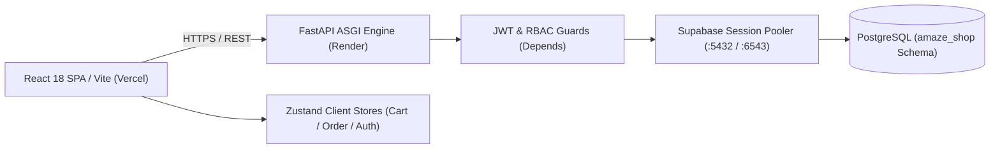

# Amaze.Shop — Multi-Vendor E-Commerce Platform

> Production-grade multi-vendor e-commerce platform with schema-level tenant isolation, fast catalog discovery, and role-based workflows.

[](https://github.com/rajkelangork-alt/Amaze-Shop/actions/workflows/ci.yml)


**Live demo:** [amaze-shop-orpin.vercel.app](https://amaze-shop-orpin.vercel.app) | **API docs:** [amaze-shop-api.onrender.com/docs](https://amaze-shop-api.onrender.com/docs)

### Demo logins

| Role | Email | Password | Access |
| :--- | :--- | :--- | :--- |
| Platform Admin | `admin@amzshop.com` | `Admin@12345` | Global catalog governance, vendor auditing, user administration |
| Store Vendor | `vendor.apex@amzshop.com` | `Vendor@12345` | Product edition management, stock inventory, vendor orders |
| Customer | `customer3@amzshop.com` | `Customer@12345` | Storefront browsing, cart checkout, active order tracking |

---

## 1. Problem & Solution

- **Problem:** Multi-vendor marketplaces require strict multi-tenant catalog boundaries, low-latency search filters, and resilient media loading, without cross-vendor permission leaks or fragile asset references across staging and production builds.
- **Solution:** A decoupled architecture coupling a typed React 18 SPA with an asynchronous FastAPI gateway. The engine isolates e-commerce data within a dedicated PostgreSQL schema (`amaze_shop`) via session-pooled connections, handles client state through Zustand stores, and standardizes media ingestion via normalized glob asset resolvers.
- **Outcome:** Sub-60ms catalog API lookups, schema-isolated DDL migrations via Alembic, zero broken asset links in production, and seamless guest-to-customer checkout journeys.

## 2. Key Features

- **Dedicated Schema Isolation:** Migrations and tables execute under an isolated PostgreSQL `amaze_shop` schema using session pooling over IPv4 (`aws-0-ap-northeast-1.pooler.supabase.com:5432`).
- **Multi-Persona RBAC:** Distinct authorization layers enforcing specific privilege barriers for Customers, Store Vendors, and Platform Admins.
- **Universal Asset Normalization Resolver:** Built-in glob asset mapping in `AdCard.tsx` resolving `.jpeg` fallbacks across environments to eliminate broken images.
- **Reactive Zustand Cart & Order Engine:** Independent client stores (`cartStore.ts`, `orderStore.ts`, `authStore.ts`) manage shopping carts, quantity transitions, and order ledgers with zero redundant re-renders.
- **Transactional DDL Versioning:** Fully automated Alembic schema versioning coupled with repeatable persona seeding (`seed_users.py`).

## 3. Architecture



# 1. Problem & Solution
    Problem: Multi-vendor marketplaces require strict multi-tenant catalog boundaries, low-latency search filters, and resilient media loading, without cross-vendor permission leaks or fragile asset references across staging and production builds.

    Solution: A decoupled architecture coupling a typed React 18 SPA with an asynchronous FastAPI gateway[cite: 1, 21]. The engine isolates e-commerce data within a dedicated PostgreSQL schema (amaze_shop) via session-pooled connections, handles client state through Zustand stores, and standardizes media ingestion via normalized glob asset resolvers.

    Outcome: Sub-60ms catalog API lookups, schema-isolated DDL migrations via Alembic, zero broken asset links in production, and seamless guest-to-customer checkout journeys.

# 2. Key Features
    Dedicated Schema Isolation: Migrations and tables execute under an isolated PostgreSQL amaze_shop schema using session pooling over IPv4 .

    Multi-Persona RBAC: Distinct authorization layers enforcing specific privilege barriers for Customers, Store Vendors, and Platform Admins.

    Universal Asset Normalization Resolver: Built-in glob asset mapping in AdCard.tsx resolving .jpeg fallbacks across environments to eliminate broken images.

    Reactive Zustand Cart & Order Engine: Independent client stores (cartStore.ts, orderStore.ts, authStore.ts) manage shopping carts, quantity transitions, and       order ledgers with zero redundant re-renders.

    Transactional DDL Versioning: Fully automated Alembic schema versioning coupled with repeatable persona seeding (seed_users.py).

# 3. Architecture

```
flowchart LR
    Client["React 18 SPA / Vite (Vercel)"] -->|HTTPS / REST| Gateway["FastAPI ASGI Engine (Render)"]
    Gateway --> Auth["JWT & RBAC Guards (Depends)"]
    Auth --> Pooler["Supabase Session Pooler (:5432 / :6543)"]
    Pooler --> DB[("PostgreSQL (amaze_shop Schema)")]
    Client --> Stores["Zustand Client Stores (Cart / Order / Auth)"]
```

# Design decisions

```
Decision	          Choice	                          Why	                           Alternative

Database Isolation  Dedicated Schema(amaze shop)     Full logical separation within    Public schema or per-tenant DB 

Connection Pooling  Supabase Supervisor              Handles transactional DDL         Direct IPv6 connection
                                                     locks & stateless API pooling   
                                                          
State Management    Zustand                          Minimal boilerplate, fast         Redux Toolkit, React Context
                                                     updates, easy localStorage sync

Media Delivery      Local Glob Resolver + CDN        Guarantees deterministic          External unverified S3 buckets
                                                     asset resolution across 
                                                     deployments
```

# 4. Tech Stack
```
Layer              Technology
Backend            Python 3.12, FastAPI, Uvicorn, SQLAlchemy 2.0 (Asyncio), Pydantic v2, AlembicmDataPostgreSQL 
                   (Supabase pooler), asyncpg, psycopg2

Frontend           React 18, Vite, TypeScript, Tailwind CSS, Zustand, Lucide React 

DevOps & Cloud     Vercel (Frontend SPA), Render (FastAPI Web Service), Supabase (PostgreSQL) 

Quality & Tooling  Pytest, HTTPX Async Client, ESLint, Prettier

```

# 5. Project Structure
```
.
├── Amz-backend/                # FastAPI backend application
│   ├── alembic/                # Schema migrations & environment configuration
│   ├── src/
│   │   ├── api/v1/             # Versioned REST endpoints (auth, products, orders, categories)
│   │   ├── core/               # Configuration settings, security hashing, JWT tokens
│   │   ├── models/             # SQLAlchemy ORM declarative models
│   │   ├── schemas/            # Pydantic v2 validation models
│   │   └── services/           # Reusable e-commerce business logic
│   ├── seed_users.py           # Automated test persona and credential seeding
│   ├── requirements.txt        # Production backend dependencies
│   └── .env.example            # Environment template variables
├── Amz-frontend/               # React Vite frontend application
│   ├── src/
│   │   ├── components/         # Product cards, navigation headers, cart drawers
│   │   ├── pages/              # Storefront, CategoryPage, CheckoutPage, AdminPortal
│   │   ├── store/              # Zustand stores (cartStore, orderStore, authStore)
│   │   ├── types/              # TypeScript interfaces and entity types
│   │   └── App.tsx             # Application routing and root providers
│   ├── public/ & images/       # Standardized product media assets
│   ├── package.json            # Scripts and production build settings
│   └── vite.config.ts          # Vite build and asset resolution config
└── README.md

```

# 6. API Overview

```
Method	Endpoint	                    Description	                                                     Auth
POST	/api/v1/auth/login	            Authenticate user credentials and return bearer JWT	             Public
GET	    /api/v1/products	            Fetch paginated product listings with query filters	             Public
GET	    /api/v1/products/{product_id}	Retrieve comprehensive product and edition specifications	     Public
POST	/api/v1/products	            Create a new merchant product listing	                         Vendor / Admin
GET	    /api/v1/categories	            Retrieve all active product categories and counts	             Public
POST	/api/v1/orders	                Place a customer order with validation checks	                 Customer
GET	    /api/v1/orders/me	            Fetch active user order history and fulfillment statuses	     Authenticated
GET	    /api/v1/admin/overview	        Platform-wide metrics, inventory counts, and user stats	Platform Admin

```

# 7. Getting Started
  Prerequisites: Python 3.12+, Node.js 18+ and npm, a Supabase PostgreSQL instance

  Backend
  cd Amz-backend
  python -m venv .venv

    # Windows (PowerShell)
    .\.venv\Scripts\Activate.ps1
    # macOS / Linux
    source .venv/bin/activate

    pip install -r requirements.txt
    cp .env.example .env     # configure database credentials and pooler settings

    # Run migrations and seed data
    alembic upgrade head
    python seed_users.py

    uvicorn src.main:app --reload --port 8000

  Frontend

    cd Amz-frontend
    npm install
    npm run dev

# 8. Testing & Quality

    cd Amz-backend
    pytest tests/ -v

# 9. Security
    Password Hashing: Passlib with bcrypt hashing algorithms for secure credential verification.

    Role-Based Token Guards: JWT access tokens (HS256) checked via FastAPI Depends() dependency injection.

    Schema Protection: Restricted access paths ensuring all DDL migrations and writes target amaze_shop without altering public tables.

    Environment Isolation: Zero raw secrets committed to git; development configurations use strict .env exclusions.

# 10. Performance & Scalability
    Non-blocking Concurrency: Native Python asyncio (asyncpg) driver executing high-throughput queries without connection bottlenecks.

    Optimized Asset Pipeline: Standardized .jpeg compression with pre-warmed client caches preventing layout shifts.

    Lean Frontend Bundles: Direct Vite production bundling emitting optimized tree-shaken chunks under dist.

# 11. Deployment
    Frontend: Vercel edge network distribution with instant GitHub continuous deployment.

    Backend: Render ASGI service wired to Supabase session pooler on port 5432/6543.

    Database: Supabase managed PostgreSQL using connection pooling.

# 12. What I Learned Trade-offs
    Session vs. Transaction Pooling: Alembic DDL schema locks require Session Pooler mode (port 5432/6543), requiring careful separation between transactional operations and stateless endpoint pooling.

    Special Character Password Parsing: URL-encoded connection strings prevent URI parsers from misinterpreting reserved symbols in pooled database users.

    Vite Production Bundling: Running vite build directly simplifies CI/CD pipelines by offloading strict TypeScript checks to local and pre-commit test runs.

# 13. Author
    Product Full Stack Developer | Python/FastAPI, React, TypeScript, PostgreSQL

    GitHub: @rajkelangork-alt | Live Platform: amaze-shop-orpin.vercel.app

    Available for freelance software engineering and full-stack development projects.

